<!-- README language switch -->
[](README.md) [](README.en.md)
**v0.13.2**: Locked hover now fades both the pet and its quota/balance bar. Refresh, resize, and unlock controls remain usable; settings and media are preserved.

<!-- /README language switch -->

<div align="center">

# Shorekeeper Codex Desktop Pet

**A desktop companion that changes expressions with your Codex tasks, with customizable GIFs, voices, and speech bubbles.**

[Download for Windows](https://github.com/Doya16/shorekeeper-codex-pet/releases/latest) · [Watch the demo](https://github.com/Doya16/shorekeeper-codex-pet/releases/download/v0.13.1/shorekeeper-codex-landscape-v0131-r2.mp4) · [User guide (Chinese)](docs/USAGE.md) · [Report an issue](https://github.com/Doya16/shorekeeper-codex-pet/issues)

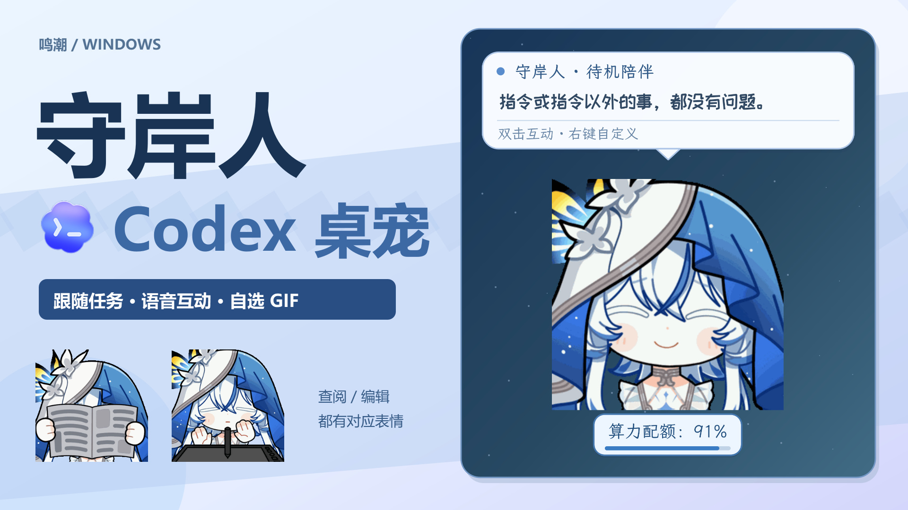

[Landscape cover](docs/social/cover-landscape.jpg) · [4:3 cover](docs/social/cover-4x3.jpg) · [Portrait cover](docs/social/cover-portrait.jpg)

</div>

For **Windows 10/11 x64**. The complete package includes three expression packs with 83 GIFs, plus 40 audio files, matching lines, and fonts. Expression bindings, playback timing, bubbles, voices, and appearance are preset. Extract the package and run it; no Python installation is required.

A [DeepSeek Harness edition](https://github.com/Doya16/shorekeeper-deepseek-pet) is also available. Both editions can run together and keep their settings separately.

## Preview

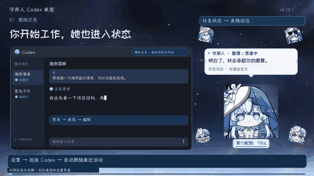

[Landscape · 1920×1080](https://github.com/Doya16/shorekeeper-codex-pet/releases/download/v0.13.1/shorekeeper-codex-landscape-v0131-r2.mp4) · [Portrait · 1080×1920](https://github.com/Doya16/shorekeeper-codex-pet/releases/download/v0.13.1/shorekeeper-codex-portrait-v0131-r2.mp4)

The **03:11** walkthrough uses **v0.13.1**, with new recordings of the pet and current settings. It covers task interactions, multiple conversation notifications, custom media, lock and click-through, mute, balance refresh, sizing, app icons, client lifecycle, update sources, and complete migration. Portrait and landscape use separate layouts.

**The client window, tasks, balances and available-update notification are examples.** Pet animations and settings are rendered from the current application. The video uses Chinese labels and character voices.

| Time | Demonstration |
| --- | --- |
| 00:01 | Task states and one opening voice per turn |
| 00:30 | Separate completion notifications |
| 00:50 | Dragging, dropping, double-clicking and head pats |
| 01:06 | Hover lock, click-through, fade and mute |
| 01:24 | Visible balance refresh and account display |
| 01:36 | GIFs, playback, paired audio/captions and frequency |
| 02:14 | Sizing, fonts and app-badged icons |
| 02:31 | Client lifecycle, update notifications and download sources |
| 02:53 | Save, migration and desktop shortcuts |
| 03:03 | Download and setup |

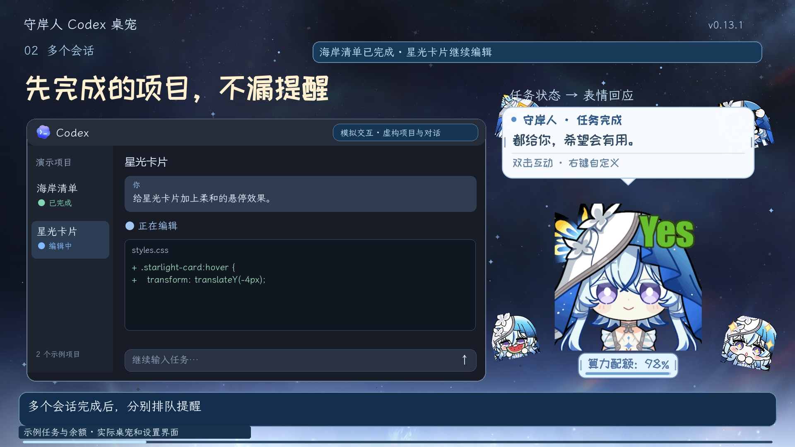

| Lock and click-through | Visible balance refresh |
| --- | --- |
| 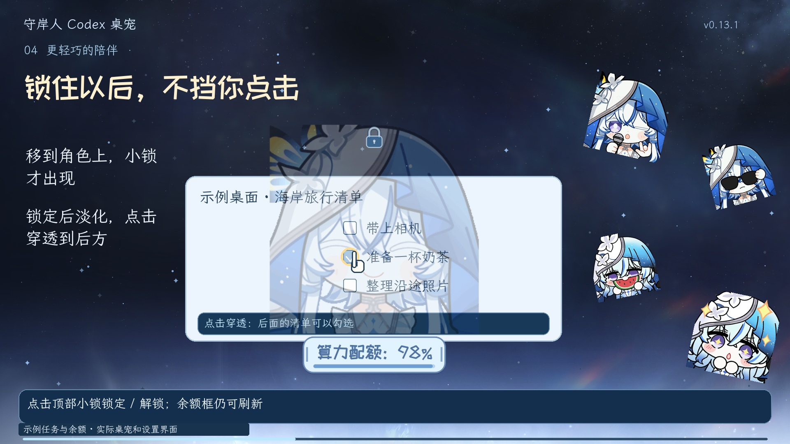 | 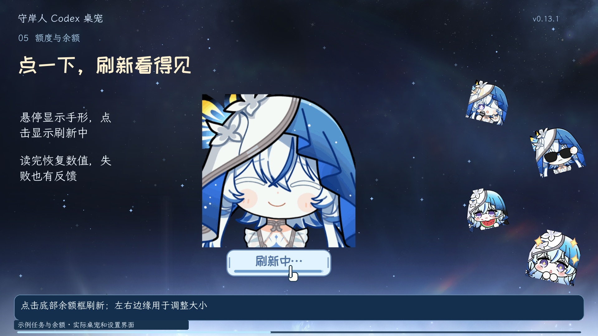 |

## Download and get started

The application uses Chinese interface labels. This guide keeps those labels alongside their English meanings so you can find the matching controls.

1. Install **Codex** on Windows and sign in.
2. Open [Releases](https://github.com/Doya16/shorekeeper-codex-pet/releases/latest) and download **Shorekeeper-Windows-v0.13.2.zip**.
3. Extract the entire archive and run **守岸人Codex桌宠启动.exe**. Keep the other folders alongside the executable.
4. Right-click the pet → **设置 → 连接 Codex → 跟随的会话 → 自动跟随最近活动** (automatically follow the current task). Open **交互工作室** (Interaction Studio) to change expressions and voices.

Sound is enabled by default at 10% volume. Adjust or disable it under **设置 → 桌面与声音** (Settings → Desktop & Sound).

## App badges and desktop shortcuts

The default pet icon has a small app badge: a black-and-white GPT mark for Codex, or a blue whale for DeepSeek. Under **设置 → 桌面与声音 → 底部栏与托盘图标**, choose **纯净图标** (plain) or **APP 小标** (badged). The taskbar/window and tray icons update immediately, and the preference travels with your settings.

The extracted Windows app creates a desktop shortcut on its first normal launch. If deleted, recreate it under **设置 → 保存与迁移 → 创建桌面快捷方式**. On another computer, extract the complete package and run it once to create a shortcut pointing to its new location.

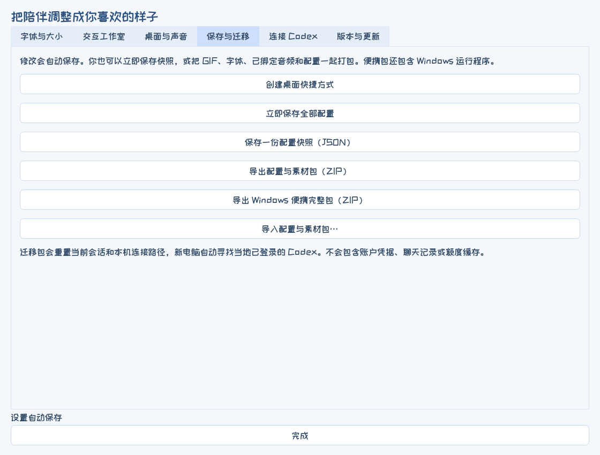

## Settings, mute and lock

Right-click the pet or tray icon → **设置…** (Settings). One window contains size and fonts, the interaction studio, desktop and sound, save and migration, client connection, and updates.

- **安静陪伴（静音）** (Mute) immediately stops current and queued audio, and silences automatic speech and previews. Unmuting restores the original volume without replaying missed speech.
- **Top lock button:** move the pointer over the character to reveal its small lock at the top center. Click to lock or unlock; it hides when the pointer leaves. Its tooltip shows **点击锁定** (Click to lock) or **点击解锁** (Click to unlock). When locked, clicks through the character reach the window underneath. Hovering fades the character; moving away restores it. The lock remains clickable to unlock, and the balance box remains clickable to refresh. Task animations and notifications continue.
- **Quota tooltip:** shows reset date/time and an hours/minutes countdown, without repeating balances. An asterisk marks data that has not been refreshed.
- **Hover fade:** adjust it under Settings → Desktop & audio, alongside lock-button size and transparency.
- **Balance refresh:** hovering inside the box shows a hand cursor. Click to show **刷新中…** (Refreshing…) in the box; it returns to the latest value when the read finishes. A failure briefly shows **刷新失败** (Refresh failed) before restoring the last reading. Repeated clicks are combined. The edges still resize the box while unlocked.
- **Compact menu:** use **设置…** for preferences and **关闭守岸人** to close. The tray also gives access to the lock setting.
- Both options save automatically and travel with exported settings and portable packages. The old quiet-companion option becomes mute; locking is off by default.


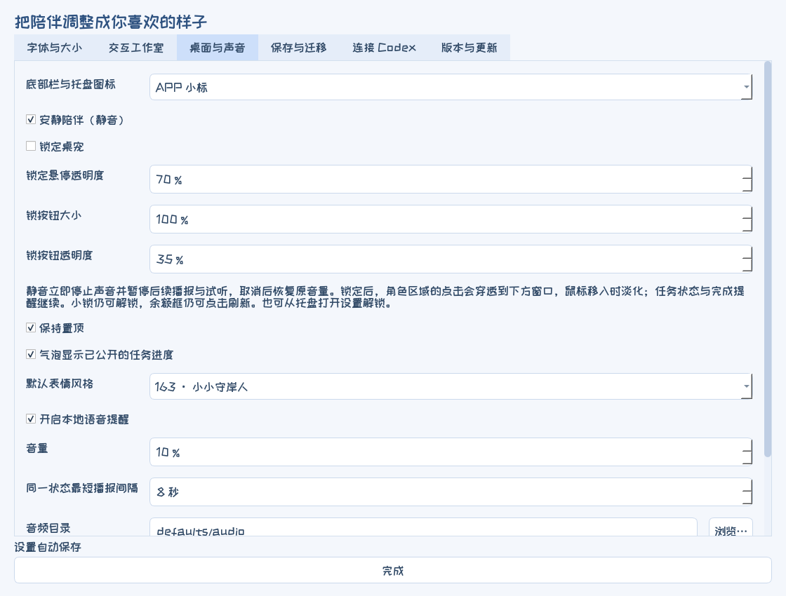

## Follow client exit

Under **设置 → 连接 Codex**, startup and shutdown follow are separate options. **随 Codex 完全退出而关闭** is enabled by default: the pet closes about 8–10 seconds after the last client instance fully exits. A client still running in the tray keeps the pet open. Brief restarts are tolerated; launching the pet before the client does not immediately close it.

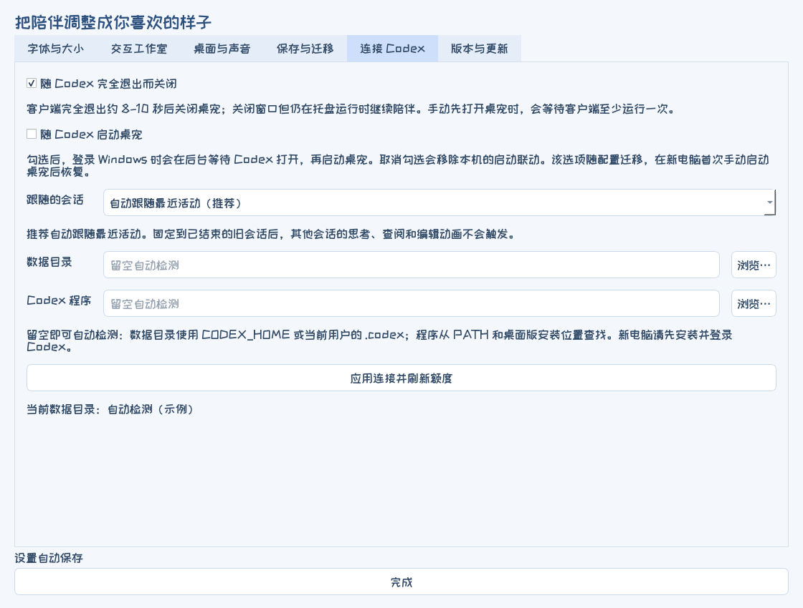

## Checking for updates and keeping your settings

Current version: **v0.13.2**. After each launch, the pet checks for a stable release and prompts you when a newer one is available. Right-click → **设置 → 版本与更新 → 立即检查更新** (Check for updates) to check manually.

Open **设置 → 版本与更新** (Settings → Version & Updates) to turn startup checks off, check immediately, or restore ignored version reminders. A new-version prompt lets you open the release page, back up settings and media, remind you later, or ignore that version. A failed background check does not interrupt the pet.

Choose **自动选择** (automatic), **GitHub 官方源** (direct), or **镜像加速（中国大陆网络）** (mirror) under Version & Updates. Automatic mode tries GitHub first and falls back when it cannot connect. A fixed choice never silently switches. The update window shows the route and offers download links for the complete package, program patch and checksums.

The third-party [GH-Proxy](https://gh-proxy.com/docs/github-accelerator) mirror handles only public release metadata and downloads; it may lag behind GitHub. Source and exit preferences travel with exported settings.

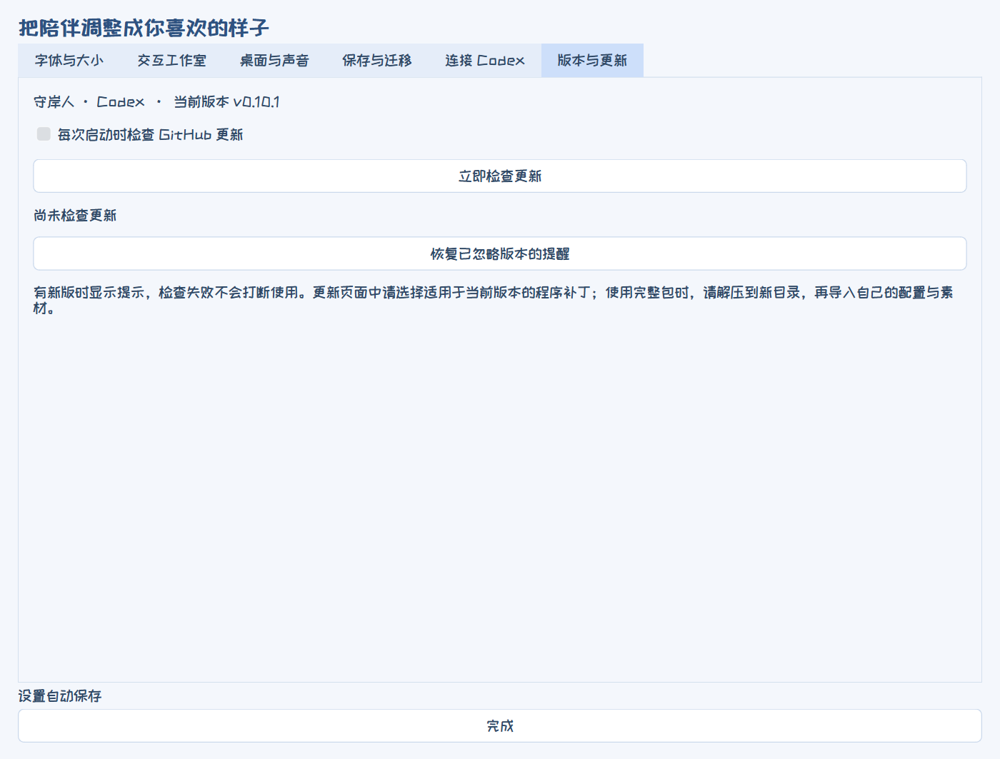

**Updates are downloaded and installed manually.** Choose the package for your installed version:

| Your installation | How to update |
| --- | --- |
| v0.13.1 | Download the [v0.13.2 program patch](https://github.com/Doya16/shorekeeper-codex-pet/releases/download/v0.13.2/Shorekeeper-Settings-Patch-v0.13.2.zip), exit the pet, extract over its existing folder, and restart |
| New installation or another older version | Extract the [v0.13.2 full package](https://github.com/Doya16/shorekeeper-codex-pet/releases/download/v0.13.2/Shorekeeper-Windows-v0.13.2.zip) into a new folder, then import your exported settings and assets ZIP if you have one |

The program patch preserves **GIFs / images, audio, bubble captions, fonts, and personal settings**. Before updating, use **保存与迁移 → 导出配置与素材包（ZIP）** (Save & Migrate → Export Settings & Assets ZIP) to keep a backup. Extract program patches into the application folder; do not import them as settings.

## Features

- **Task following:** switch expressions when Codex is thinking, reading, editing, waiting, or finished. When multiple projects run at once, completion notifications play in sequence before returning to the active task.
- **Mouse interactions:** configure separate responses for a single-click head pat, double-click, dragging, dropping, and offering milk tea.
- **Custom assets:** choose a GIF or image for each interaction and adjust looping, speed, hold time, and the next state.
- **Voices and lines:** add multiple voice clips to one action, pair each with bubble text, and play a randomly selected pair.
- **Appearance and quota:** resize in real time, change fonts and font sizes, and show included usage remaining, switching to the separate credit balance when the allowance is exhausted.
- **Update reminders:** startup and manual checks, with remind-later and ignore-version options.
- **Save and migrate:** package GIFs, audio, bubble text, fonts, and all settings for another computer.

The thinking introduction voice can play just once per task turn. When the GIF changes, the current voice continues until it finishes. Idle voices play only once per pet launch by default; you can also choose every entry or occasional playback based on a probability and minimum interval. Manual previews do not count toward automatic playback limits.

**Launch with Codex:** right-click → **设置 → 连接 Codex** (Settings → Connect to Codex) → enable **随 Codex 启动桌宠** (launch the pet with Codex). Uncheck it to disable the connection. This option is off by default and migrates with your settings. On a new computer, it is restored after you launch the pet manually for the first time.

**Audio and tray:** Windows Volume Mixer lists the pet as **守岸人 · Codex**, so you can adjust its volume separately. Its tray tooltip identifies the Codex edition; click the icon to show or hide the pet.

| Voice playback frequency | Launch with Codex |
| --- | --- |
|  | 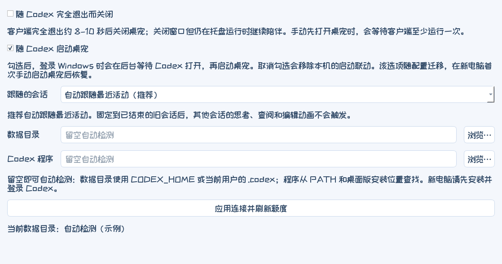 |

Bubble width and quota bar size can be adjusted and previewed independently, then scale with the pet using their saved proportions. Long lines wrap automatically without truncating text or limiting the number of lines. With **自定义音频+字幕** (custom audio + subtitles), only the text paired with the selected voice appears, and the bubble closes when playback ends; the action's generic lines do not appear afterward. In the bundled configuration, this mode is already enabled for actions with paired voices and subtitles.

## Included usage and credit balance

The bar shows **算力配额：98%** (included usage remaining) for the account's usage window. It is not money or a fixed number of requests. When the allowance is exhausted and the account returns a credit balance, the bar switches to **超限配额：1,234.56** (credit balance), with a purple border and centered text in a compact frame, without space reserved for a progress bar. The included-usage frame uses a soft Shorekeeper blue palette.

Credit mode refreshes about every **30 seconds**; included usage refreshes about every **2 minutes**. Right-click → **刷新额度** to refresh immediately. After the allowance resets, the percentage display returns. Hover to see the next reset date, time, and countdown. Missing balances stay unknown; failed refreshes mark the last reading as cached.

Credit consumption depends on model, input/output, caching, and other usage factors. Credits are separate from the included allowance; showing a balance does not establish that an individual request was billed. See the [official usage guide](https://learn.chatgpt.com/docs/pricing).

## Customization

Right-click the pet → **设置 → 交互工作室** (Interaction Studio). Select an action on the left, then change its settings on the right.

| What to change | Where to find it |
| --- | --- |
| Expression or image | **GIF 素材** (GIF assets) → click a thumbnail |
| Add your own assets | **导入图片** (import images); or open the asset directory, add files, and refresh assets |
| Looping, speed, hold time, next state | **播放与切换** (Playback & Transitions) |
| Bubble text, font, font size | **气泡与字体** (Bubbles & Fonts) |
| Show only the text paired with the selected voice | **气泡与字体 → 气泡内容 → 自定义音频+字幕** (Bubbles & Fonts → Bubble Content → Custom Audio + Subtitles) |
| Bubble width, quota bar size, and previews | Right-click → **调整大小** (Resize); or drag the small vertical handles on either side |
| Multiple voices with individually paired text | **语音与配对气泡** (Voices & Paired Bubbles) → add multiple files → select one to edit |
| Idle voice once, on every entry, or occasionally | **待机陪伴 → 语音与配对气泡 → 自动播报频率** (Idle Companion → Voices & Paired Bubbles → Automatic Playback Frequency) |
| Play the task-start voice once per turn | **思考状态 → 自动播报频率 → 同一轮任务只播一次** (Thinking → Automatic Playback Frequency → Once per Task Turn) |

| Custom expressions | Paired voices and bubbles |
| --- | --- |
|  | 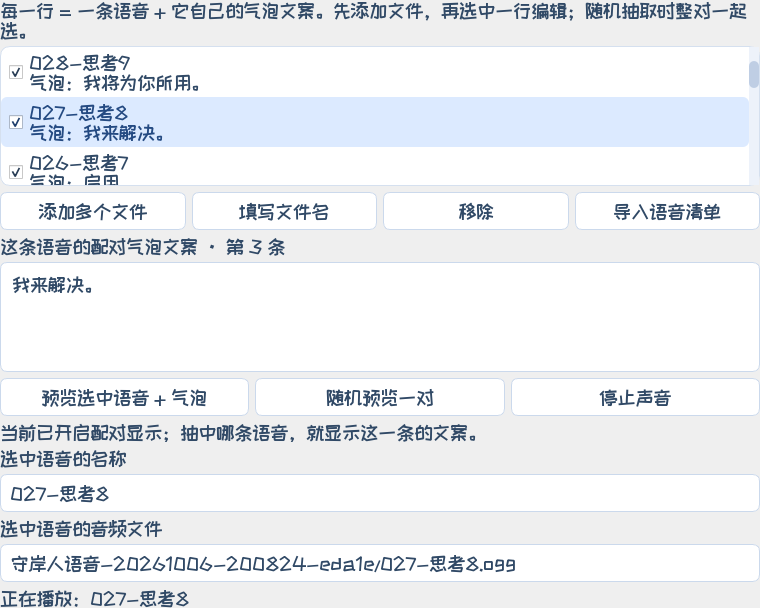 |

Supported images: GIF, animated WebP, PNG, JPG/JPEG, and static WebP. Audio: WAV, MP3, OGG, FLAC, M4A, and AAC. Fonts: TTF, OTF, and TTC. Place a UTF-8 TXT file with the same base name beside an audio file to import its lines automatically. The pet also works without added audio.

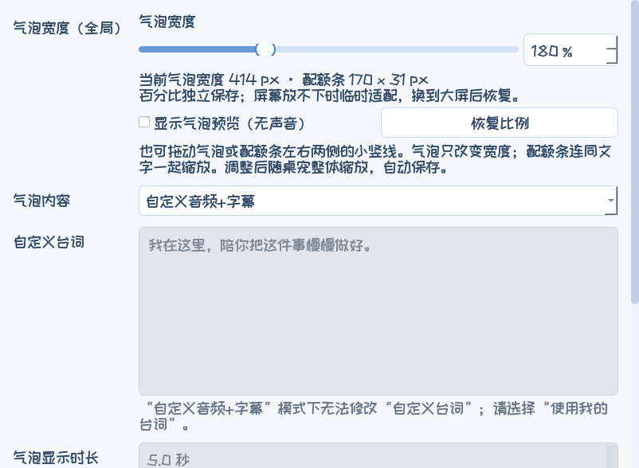

If a voice clip's paired text is empty, that clip displays no bubble. When using default content or **使用我的台词** (use my lines), the bubble shows only the selected content. Other lines you have entered are retained and can be edited again after switching modes.

**Resizing:** right-click → **设置 → 字体与大小** (Settings → Fonts & Size), or hold **Ctrl + mouse wheel** while hovering over the pet. Bubble width and quota bar size have separate sliders and percentage fields. Enable **显示气泡预览（无声音）** (show bubble preview, without sound) to adjust the bubble even when no line is playing. Drag either edge of a visible bubble or either side of the quota bar; text scales along with it. Changes save automatically, and subsequent overall resizing preserves both relative proportions.

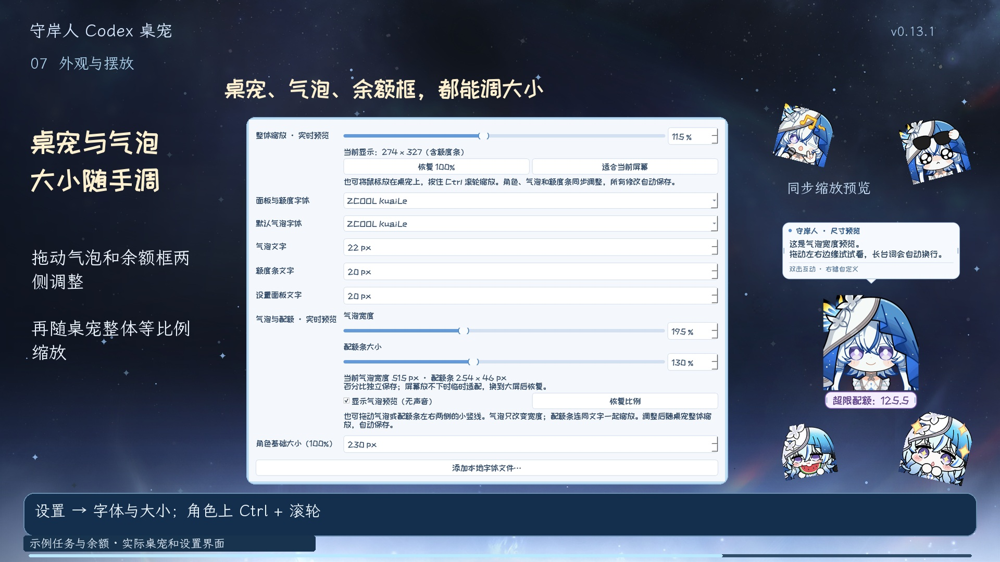

[View the complete resize panel](docs/demo/resize-controls.png)

Bubble width ranges from 75% to 400% of the character width; the quota bar ranges from 50% to 250% of its original size. If it does not fit on screen, the layout adjusts temporarily without overwriting your saved proportions. See the [user guide (Chinese)](docs/USAGE.md) for detailed format limits and settings.

## Saving and migration

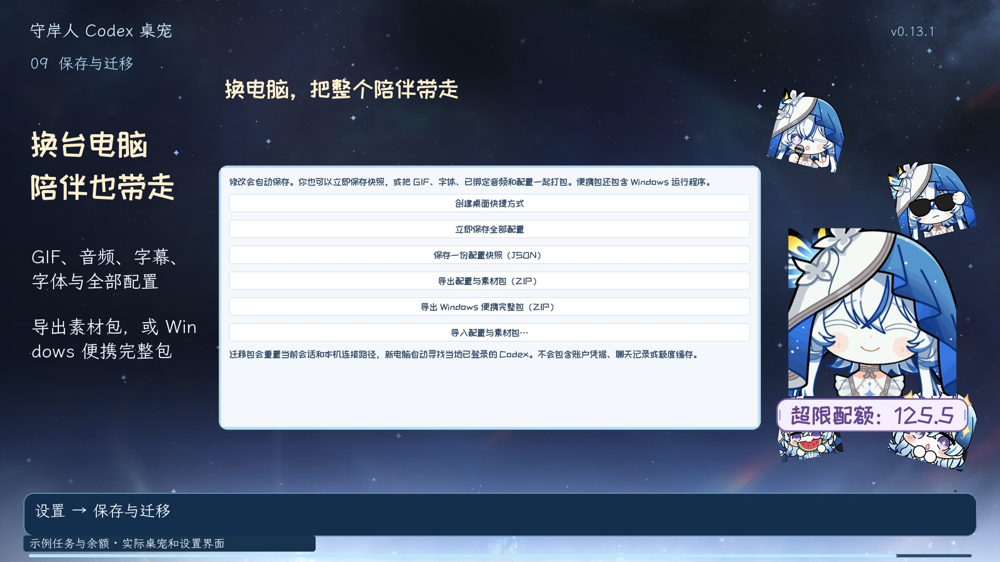

Changes save automatically. To save or export manually, use **right-click → 设置 → 保存与迁移** (Settings → Save & Migrate).

| Export format | Includes |
| --- | --- |
| JSON snapshot | Configuration text and options |
| Settings and assets ZIP | GIFs / images, audio, fonts, bubble text, all settings, and default settings |
| Complete portable Windows package | Settings, assets, and the runnable application |

On another computer, install Codex and sign in, fully extract the portable package, and run **守岸人Codex桌宠启动.exe**. The connection is detected again automatically, your custom content remains, and you can continue exporting it.

## FAQ

**Expressions do not follow a new task?** Open **设置 → 连接 Codex → 跟随的会话** and select **自动跟随最近活动** (automatically follow the current task). Change a pinned session under **设置 → 连接 Codex** (Settings → Connect to Codex).

**A `*` after the quota, or `--` instead of a value?** `*` indicates cached data; `--` means no data is available. Right-click → **刷新额度** (refresh quota). Hover to see the next reset date, time, and countdown.

**Some numeric fields are greyed out?** The current mode does not use that setting. Hover for a hint. For example, adjusting the hold time after a single playback requires a compatible playback mode.

**The pet did not launch with Codex?** Update to the latest version, launch the pet manually once, and enable **随 Codex 启动桌宠** (Launch with Codex). After moving its folder, launch it manually from the new location once.

**Something else went wrong?** Open an [issue](https://github.com/Doya16/shorekeeper-codex-pet/issues) with your Windows version, reproduction steps, and a screenshot of the error.

## Asset sources and acknowledgments

Expression assets come from **[呜哇小站 · 表情包仓鼠库](https://emoji.wuwa.games/)**.

**Expression pack crowdfunding QQ group: 1079834905**

Thank you to all the Shorekeeper fans who crowdfunded and supported the expression packs used in this project.

Rights to the character, images, and original voices belong to their respective owners. Expression packs are for personal, noncommercial use only; do not resell them or include them in paid distribution. Licenses for application dependencies and fonts do not apply to character assets. See [asset credits](assets/CREDITS.txt) and [third-party licenses](THIRD_PARTY.txt).

<details>
<summary>Run from source</summary>

Install Python 3.12 and run these commands in the project directory:

```powershell
python -m venv .venv
.\.venv\Scripts\python.exe -m pip install -r requirements.txt
.\.venv\Scripts\python.exe -m shorekeeper_pet
```

Start from the root-level **守岸人Codex桌宠启动.vbs**, or use the commands above. Application modules are in `shorekeeper_pet/`; build, validation, and shortcut tools are in `tools/`. To launch from another directory, use `python path/to/project/tools/run_pet.py`, replacing `path/to/project` with your project path.

To build a portable package, run `.\.venv\Scripts\python.exe -m pip install -r tools/requirements-build.txt`, then `.\.venv\Scripts\python.exe tools/build_portable.py`. Output is written to `dist/守岸人Codex桌宠/`.

Run checks with `.\.venv\Scripts\python.exe -m unittest discover -s tests`.

</details>
